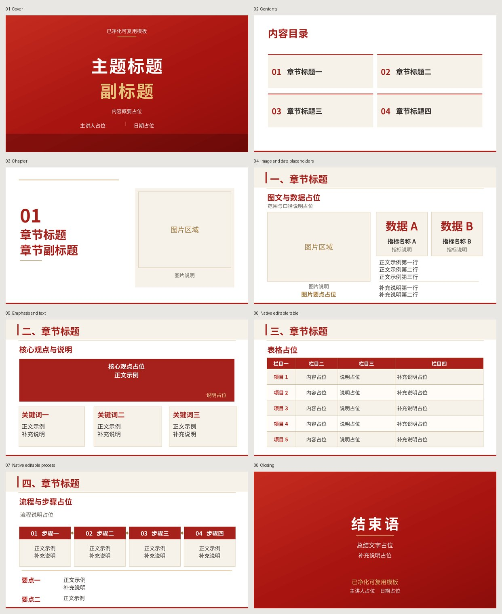
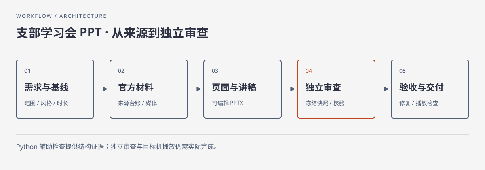

# branch-study-ppt

**把学习材料组织成能讲清、能编辑、能追溯的专题学习会 PPT。**

面向中文支部专题学习会，串联官方来源核验、逐页内容规划、红金版式、讲稿与视频时长预算，以及独立审查。你给出主题、资料和本轮要求，智能体依据宿主实际能力制作可编辑 PPTX，记录每个结论的来源与验收状态。

[开始使用](#开始使用) · [模板预览](#模板预览) · [制作流程](#制作流程) · [环境与兼容](#环境与兼容) · [验证边界](#验证边界)

## 能完成什么

| 环节 | 你得到的内容 |
|---|---|
| 官方来源核验 | 主文章、事实主张与出处台账，标明时效和待核实项 |
| 逐页规划 | 每页主问题、可见证据、解释和分区安排 |
| 可编辑演示 | PPTX 正文、表格、流程形状与逐页讲稿；按任务补齐图表和媒体 |
| 时长预算 | 口播、视频与切换余量分别计算，预先发现无法满足的时长组合 |
| 送审与修订 | 候选文件指纹、独立快照、逐页问题清单及复审记录 |

默认以学习强国作为主源、官方站点补充核验；口播加视频为 40—45 分钟，现场总时长控制在 45 分钟内。具体主题、页数与视频数量依据实际材料决定，用户明确要求优先于默认值。

## 模板预览



[下载可编辑模板](assets/template.pptx)。随包资产含封面、目录、章节、图文数据占位、重点正文、原生表格、原生流程和结束页八种版式。上图是模板预览，包含通用占位文字，不是完成的学习会案例。图片、数据、视频与讲稿须根据实际任务补齐。

模板不嵌入字体；预览使用 Noto Sans CJK SC 替代字体，PPTX 引用 Microsoft YaHei。目标电脑须检查中文字体与重新渲染后的版面。

## 开始使用

将**整个仓库**放到宿主技能目录，保持根目录 `SKILL.md`、`references/`、`scripts/` 和 `assets/` 在一起。以下命令从你的项目根目录执行，需要已安装 Git；目标目录存在时先检查已有内容，不覆盖。

**Codex：项目技能目录**

```sh
git clone https://github.com/2kilo3/branch-study-ppt.git .agents/skills/branch-study-ppt
```

**Claude Code：项目技能目录**

```sh
git clone https://github.com/2kilo3/branch-study-ppt.git .claude/skills/branch-study-ppt
```

**DeepSeek harness（dsh）：项目技能目录**

```sh
git clone https://github.com/2kilo3/branch-study-ppt.git .dsh/skills/branch-study-ppt
```

此路径按官方 `skill-filesystem` 文档配置，需宿主启用相关技能能力；本轮未执行 dsh 加载测试。

无 Git 时可下载仓库 ZIP，解压后将含 `SKILL.md` 的完整目录命名为 `branch-study-ppt`，放入对应目录。重新打开或刷新宿主后确认已发现技能；自动发现行为以当前宿主版本为准。

调用示例：

```text
请使用 branch-study-ppt，根据我提供的官方资料制作一份专题学习会 PPT。
主题：[主题]；日期：[日期]；素材：[文件或公开链接]。
要求：沿用红金版式，提供可编辑 PPTX、逐页讲稿和来源台账。
开始前检查现有工具，按实际视频时长安排口播和现场余量。
```

其他 Agent 可直接使用：

```text
先读取 branch-study-ppt/SKILL.md，再按链接加载当前步骤所需文件。
本轮任务是：[主题、输入资料、输出位置和验收要求]。
请先核对实际具备的来源访问、PPTX 编辑、渲染和独立审查能力。
```

通用显式读取不等于宿主已实现自动发现、安装或工具兼容。DeepSeek harness（dsh）的入口与能力差异见[可移植说明](references/portability.md)。

## 制作流程



需求与基线 → 官方来源 → 主张和媒体台账 → 逐页计划与时长 → 代表页适配 → 全稿与渲染 → 独立审查 → 修复复审 → 验收交付。

每一步都有可核对的输入、产物和完成条件；在 `run-state` 中记录当前位置和下一步。来源或页面变化时，更新受影响的台账与审查结论。独立审查使用不继承作者对话的新上下文，不能用作者换角色自检代替。

完整方法见 [SKILL.md](SKILL.md) 和 [workflow.md](references/workflow.md)。写作规则将 Humanizer-zh 与 anti-defensive-writing 的适用原则改写为本地参考：减少套话与无必要自辩，同时保留正式文体、原意和事实边界，见 [writing.md](references/writing.md)。无需额外安装这两个技能。

## 环境与兼容

阅读和使用文档无需 Python；辅助脚本仅使用 Python 标准库，**没有 pip 或 npm 依赖**。API 静态下限为 Python 3.7，建议使用仍受维护的 Python 3.11 或更高版本；不同版本的实测范围见[运行说明](references/runtime.md)。

| 能力层 | 需要什么 | 缺失时怎样处理 |
|---|---|---|
| 技能加载 | 能读取 Markdown 与相对引用 | 保留完整目录，显式读取 `SKILL.md` |
| 辅助计算检查 | Python 标准库 | 可先完成资料和规划；标明脚本检查未执行 |
| 制作 PPTX | 宿主演示工具、PowerPoint 或可用制作库 | 缺 `python-pptx` 不代表全部制作能力缺失；逐项检查替代工具 |
| 全页视觉检查 | 实际可用的 PPTX 渲染器与中文字体 | 标明受阻范围，不能用 XML 检查代替视觉验收 |
| 视频验收 | 媒体时长、解码和目标播放器 | 区分嵌入、解码、播放与声音的已验证状态 |
| 独立审查 | 真正全新上下文 | 保留候选与问题，明确独立审查尚未完成 |

不会自动安装依赖、修改全局配置或关闭安全限制。具体路径、系统差异与恢复策略见[可移植说明](references/portability.md)、[工具链](references/toolchain.md)和[来源恢复](references/source-recovery.md)。

## 辅助脚本

在技能根目录运行；如果本机命令是 `python3` 或 `py -3`，替换命令开头即可。

```sh
# 离线检查包文件、Python 与 UTF-8 管道
python -B -X utf8 scripts/preflight.py

# 12 分钟视频、2 分钟现场余量下的讲稿字数预算
python -B -X utf8 scripts/plan_timing.py --video-seconds 720 --reserve-seconds 120

# 检查一份实际 PPTX：参数是全稿总量
python -B -X utf8 scripts/audit_pptx.py candidate.pptx --video-seconds 720 --transition-seconds 120

# 合成回归测试：只在临时目录创建测试材料
python -B -X utf8 -m unittest discover -s scripts -v
```

`audit_pptx.py` 只读检查 PPTX 结构、显式字号、简单对象边界和讲稿字数估算；退出 0 表示检查完成，报告仍可能包含问题。它不判断事实正确、视觉质量或 PowerPoint 播放效果。`freeze_review.py` 可按明确文件清单创建新快照，拒绝覆盖已有目标；用法见[送审控制](references/review-control.md)。

## 验证边界

本次发布的脚本和文档核验记录见 [docs/validation.md](docs/validation.md)。完整演示仍须在每次任务中核验资料、全页渲染、媒体与目标机器。没有条件完成的检查如实标为待验证。

发布包不含真实组织、主讲人、用户原稿、照片、视频、凭据或运行日志。资产中的占位文字只是版式说明。脚本报告可能含调用者提供的路径与材料摘录，应放在项目工作目录内并审查后再分享。安全与权限范围见 [security.md](references/security.md)。

## 目录导航

- [SKILL.md](SKILL.md)：Agent 入口与任务边界。
- [references/](references/)：制作、写作、来源、时长、媒体和复审方法。
- [scripts/](scripts/)：可选离线辅助工具与合成测试。
- [assets/](assets/)：八页通用模板、预览和空白运行状态。
- [docs/github-about.json](docs/github-about.json)：仓库 About 简介与 topics。

## 来源与使用边界

写作原则来源及改写方式见 [来源说明](docs/sources.md)。随包未附上游技能全文，也不要求读取其他已安装技能。官方新闻与媒体应在实际任务中逐项核对使用条件；本仓库不替素材授予再分发许可。

本仓库未声明覆盖全部代码与资产的统一开源许可证；公开可读不等于获得任意再分发授权。新增整体许可证前需由权利人确认适用范围。
